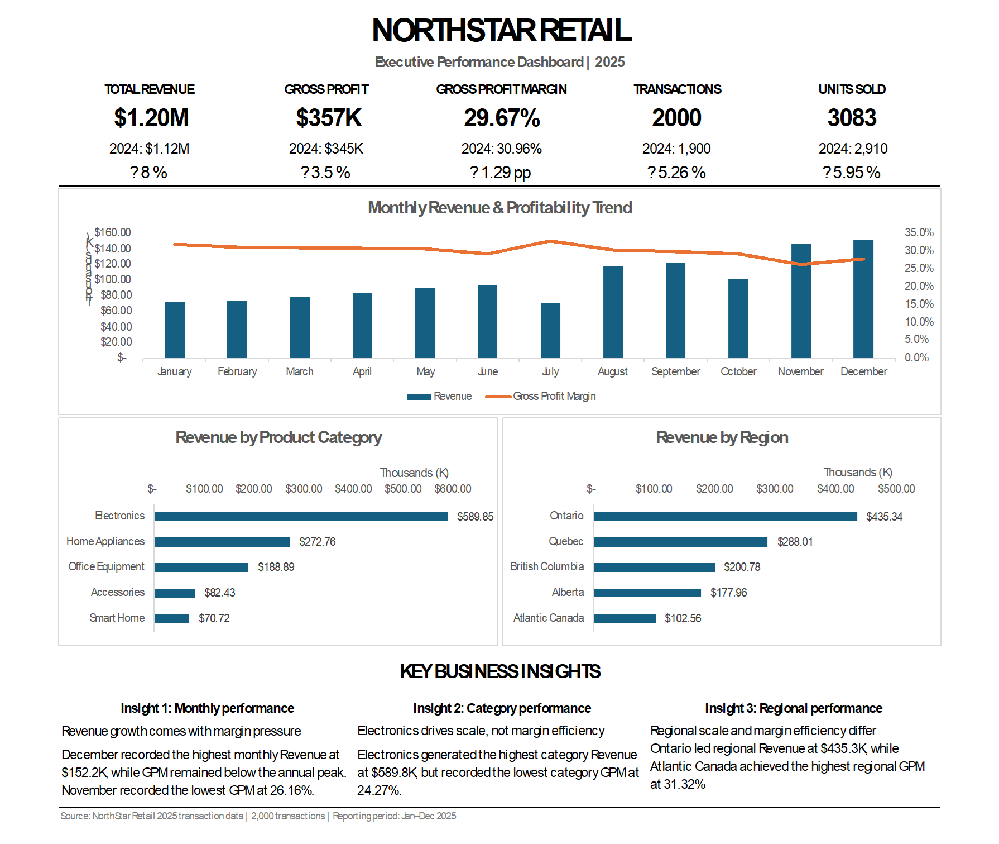
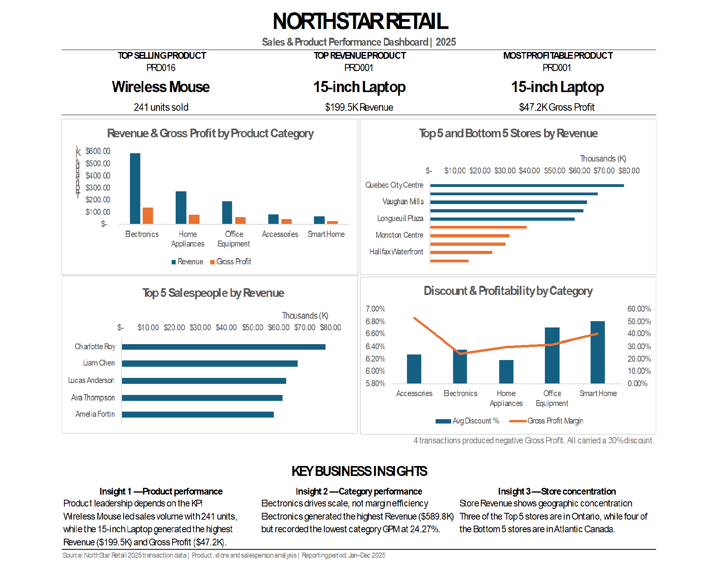
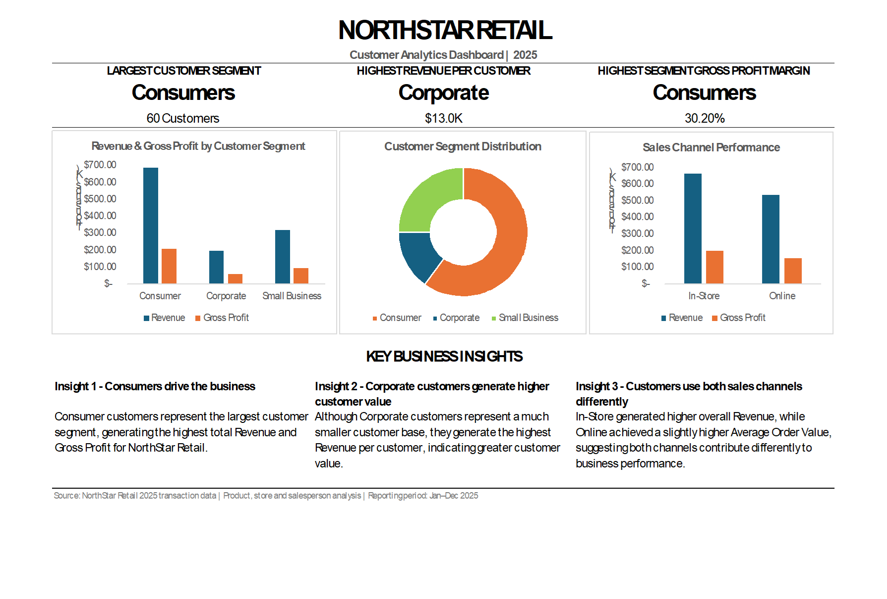

# NorthStar Retail Analytics
### Excel Business Performance Analysis | Professional Portfolio Case Study

**Project by Amrutha Puthiyidath Nair | Insight Foundry**

## Project Overview

NorthStar Retail Analytics is an end-to-end Excel business analytics case study developed using a fictional retail company and 2,000 synthetic sales transactions from January to December 2025.

The project examines business performance across revenue, gross profitability, products, customer segments, sales channels, and geographic regions.

The objective is to demonstrate how raw business data can be transformed into meaningful KPIs, interactive dashboards, analytical insights, and practical management recommendations.

This project also forms the analytical foundation of NorthStar Retail Analytics, the first educational digital product developed under Insight Foundry.

## Business Problem

NorthStar Retail experienced revenue growth, but gross profit did not increase at the same rate.

Management needed to understand:

- Why was gross profit margin declining despite higher revenue?
- Which products and categories contributed most to revenue and profitability?
- How did business performance vary across regions and sales channels?
- What opportunities existed to improve profitability and decision-making?

## Dataset Overview

| Attribute | Description |
|---|---|
| Business | Fictional retail company |
| Analysis Period | January–December 2025 |
| Transactions | 2,000 |
| Customers | 100 |
| Stores | 25 |
| Salespeople | 25 |
| Data Type | Synthetic |
| Primary Tool | Microsoft Excel |

## Tools and Techniques

- Microsoft Excel
- PivotTables and PivotCharts
- XLOOKUP and Excel formulas
- Data cleaning and validation
- KPI development
- Dashboard design
- Business performance analysis
- Data visualization and storytelling

## Key Performance Indicators

| KPI | 2025 Result |
|---|---:|
| Total Revenue | $1,204,636 |
| Gross Profit | $357,391 |
| Gross Profit Margin | 29.67% |
| Transactions | 2,000 |
| Units Sold | 3,083 |

## Key Analytical Findings

### 1. Revenue Growth Outpaced Gross Profit Growth

Using supplied 2024 comparison benchmarks, revenue increased approximately 8.0%, while gross profit increased approximately 3.5%.

Gross profit margin decreased from approximately 30.96% to 29.67%.

This highlighted the need to evaluate profitability alongside revenue growth.

### 2. Electronics Dominated Revenue

Electronics generated approximately $589,845, representing 49% of total revenue.

However, the category's gross profit margin was approximately 24.3%, below the company-wide margin.

### 3. Product Performance Varied

The 15-inch Laptop generated approximately $199,509 in revenue and $47,189 in gross profit.

The Wireless Mouse recorded the highest sales volume, with 241 units sold.

### 4. Regional Profitability Differences

Ontario generated the highest revenue, while Atlantic Canada recorded the highest regional gross profit margin.

These differences suggest opportunities for further investigation into product mix, pricing, and discounting.

### 5. Discount-Related Exceptions

The analysis identified a small number of transactions with negative gross profit.

These exceptions highlighted the importance of transaction-level validation and discount monitoring.

## Business Recommendations

1. Review pricing and discount practices for low-margin products.
2. Investigate opportunities to promote complementary, higher-margin products.
3. Monitor category-level gross profit margins alongside revenue.
4. Examine regional differences before implementing pricing or promotional changes.
5. Develop exception reporting for transactions generating negative gross profit.

These recommendations represent analytical opportunities rather than measured business outcomes.

## Dashboard Showcase

### 1. Executive Performance Dashboard

**Focus:** Revenue, gross profit, gross profit margin, and monthly performance trends.

### 2. Sales & Product Dashboard

**Focus:** Product rankings, category profitability, and sales performance.

### 3. Customer Analytics Dashboard

**Focus:** Customer segments, purchasing behaviour, and customer-related KPIs.

---

## Professional Case Study

[**View the Complete Professional Case Study (PDF)**](case-study/NorthStar_Case_Study.pdf)

The case study explains the business problem, methodology, findings, recommendations, and project limitations.
## Professional Case Study

A detailed PDF case study documents the business scenario, analytical approach, key findings, recommendations, and project reflection.

The case study will be available in the `case-study` folder.

## Project Limitations

- The dataset is synthetic and does not represent a real operating business.
- The 2024 comparison values are supplied scenario benchmarks, not independently analyzed transaction records.
- Observed relationships do not establish causation.
- Recommendations have not been implemented or measured against actual business outcomes.

## About Insight Foundry

**Insight Foundry | Learn · Analyze · Grow**

Insight Foundry develops practical, project-based analytics learning resources that encourage learners to think like analysts, solve business problems, and communicate meaningful insights.

**Educational Product:** [Explore NorthStar Retail Analytics on Etsy](https://www.etsy.com/ca/listing/4596471801/excel-data-analytics-project-retail)

---

*This repository showcases the professional analytics case study. The complete guided educational product is available separately through Insight Foundry.*
